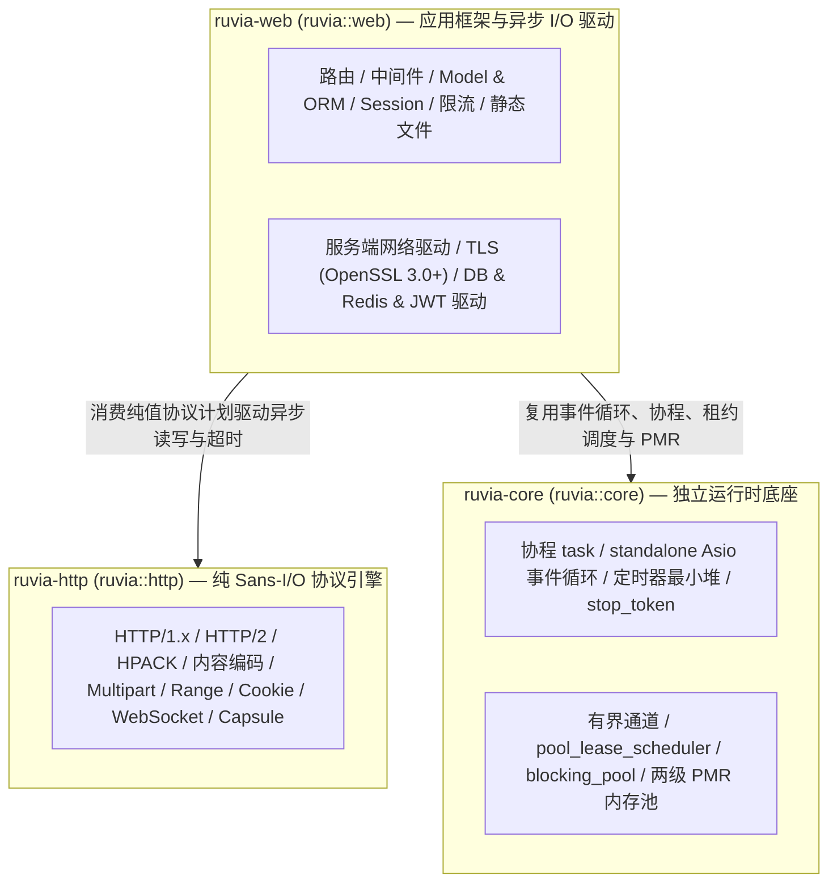
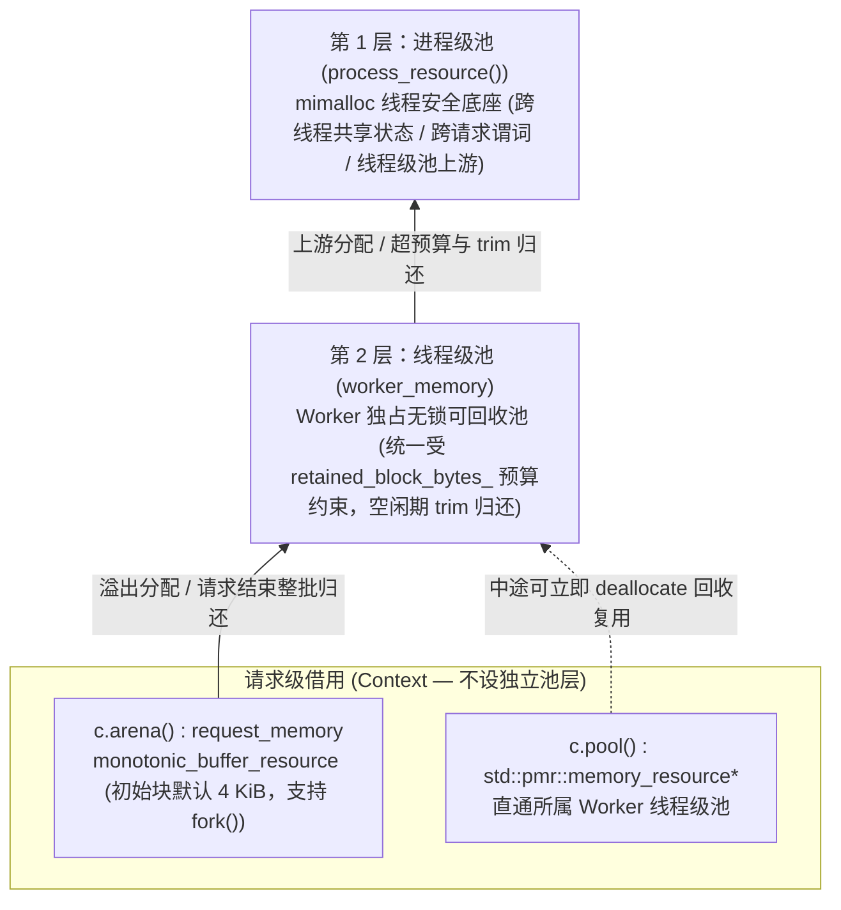
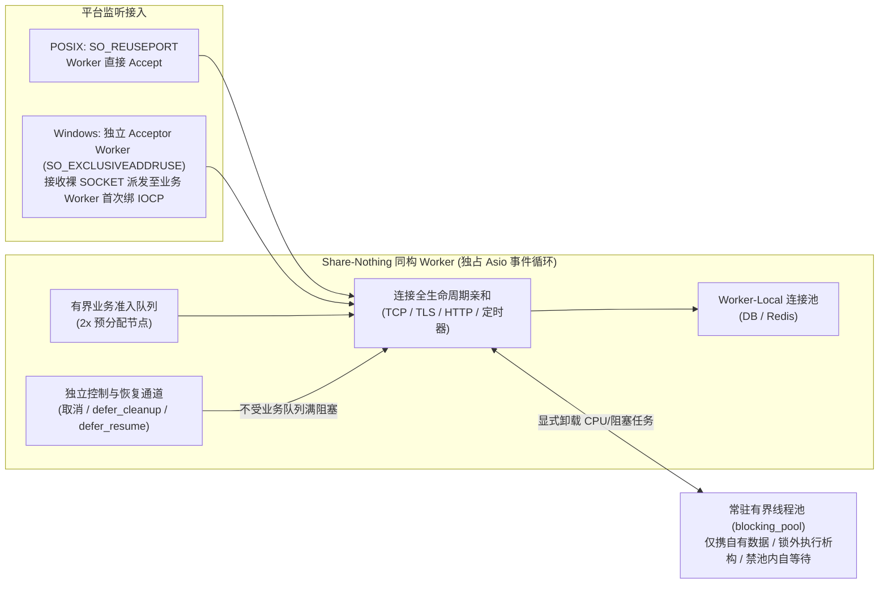
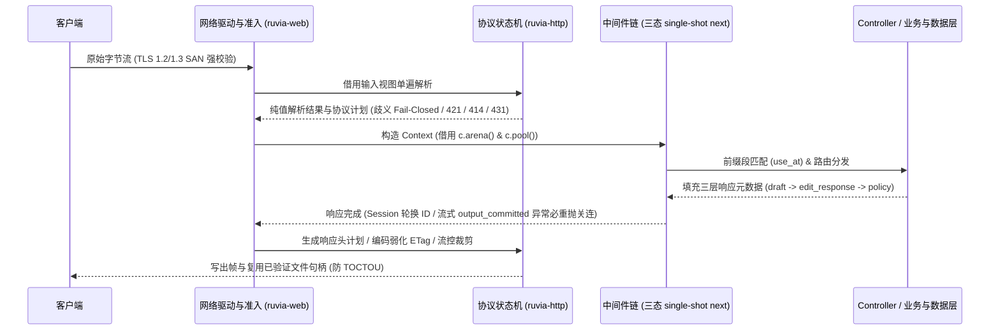

# AGENTS.md

默认使用中文沟通与编写文档，路径、命令、代码与标识符保留原文。
本文件仅定义全局**工程准则**、**核心编程范式**与**核心架构约束**，不作记事本。`README.md` 面向使用者提供最短接入入口；代码风格统一遵守 `STYLE.md`。

---

## 1. 工程准则

- **改动纪律**：修改前检查 `git status`，保留已有改动，不擅自回退、覆盖或夹带无关修改。
- **自主决策**：上下文与现有契约可推导时直接执行，仅在存在实质性歧义或重大权衡时问一个必要问题。
- **优先级准则**：正确性与并发安全第一，其次长期可维护性，最后是经实测证明的性能。
- **少即是多（Less is More）**：能删则删、能简则简，新增设计只服务当前明确需求，至少两个真实调用方共享才提取抽象。
- **反过度设计**：严禁预设扩展点、单用法泛型/策略层、无状态包装或将同步/非事务操作伪装成异步/事务。
- **遵循标准**：严格遵守现行 RFC（HTTP 参照 RFC 9110/9111/9112/9113，TLS 1.3 参照 RFC 9846）及勘误，区分 MUST/SHOULD/MAY 与收发/代理义务，不把发送方限制当成接收方拒绝规则。
- **借鉴权威**：优先借鉴同领域权威项目（如 Pingora）的成熟机制，不闭门造车，不以主观“更严格”代替标准。
- **单一权威实现**：同类能力统一入口、共用唯一主链与状态机，不维护平行分叉实现。
- **零技术债务与纯粹契约**：不为缩小 diff 塞入兼容开关，内部代码、协议、存储与缓存保持当前唯一契约，不引入无外部标准依据的内部版本号或代次后缀。
- **公开 API 边界**：公开 API（`include/` 下非 `detail` 符号）服务外部使用方，必须覆盖本库全部能力，未经允许不改变公开契约。
- **语义化命名与注释**：名称直接反映对象、职责与动作（禁用 `Manager`、`Helper`、`Processor`、`Util`、`Data`、`handle` 等泛称），注释仅解释意图、不变量、所有权边界与 RFC 条款。

---

## 2. 架构分层与 Sans-I/O 边界

- **单向无环依赖**：`ruvia-http` 不依赖 `core`、Asio、socket、定时器、OpenSSL 或 mimalloc；`ruvia-core` 不含任何 HTTP/Web、TLS、压缩或数据后端语义。
- **跨库契约与 Include Firewall**：跨库只用非 `detail` 公开 API，严禁穿透内部头；核心入口头（如 `context.h`）对独立子系统句柄优先使用前置声明。
- **模块内聚**：同职责代码保持内聚，大型状态机仅按正交阶段拆分并共享单一内部状态头，不拆碎片文件或胶水层。
- **Sans-I/O 协议解耦**：`ruvia-http` 仅在计算期借用输入视图，产出只含纯值状态与区间的协议计划，流控信用以移动唯一、析构自动归还的线性令牌交付。
- **驱动执行与防 TOCTOU**：`ruvia-web` 消费协议计划驱动异步 I/O，直接复用构帧阶段已打开并验证身份的原生文件句柄（内联小文件写出前二次校验身份，阻塞池预读复制独立 `fd`），不在驱动层二次解析协议语法。
- **链接与安装闭包**：非 Windows 下 `ruvia-core` 以 `WHOLE_ARCHIVE` 链接静态 `mimalloc-static`，Windows 使用 MSVC 静态运行时与 mimalloc；可选特性关闭时同步剔除对应源码与安装头目录。

---

## 3. 核心编程范式

- **组合与单一主模板**：优先值语义、纯数据聚合与 `concept` 约束，拒绝深层继承；需同时支持 `T` 与 `void` 的泛型任务通过统一 `result()` 接口保持单一主模板。
- **具名控制流**：避免深层回调或 lambda 嵌套，复杂分支与多阶段异步流程提取为具名函数或协程。
- **类型驱动不变量**：互斥阶段与结果用 `std::variant` 建模，结果类型固定构造期类别并 `= delete` 赋值，部分失败同时携带错误码与有效进度。
- **数据错误与内部故障分层**：预期内的数据/格式/配额错误以值语义返回，内存分配或底层系统初始化失败直接抛异常。
- **三态查找与流处理器重置**：唯一字段查找显式返回 `absent / found / repeated` 三态；有状态流处理器维护 `active / finished / failed` 三态，仅经显式 `reset()` 复用内存。
- **编译期借用防线**：跨表达式留存的视图（`borrowed_text`、`borrowed_span`）编译期拒绝绑定右值临时容器，视图入口 `= delete` `std::initializer_list` 重载，内部访问器标注 `RUVIA_LIFETIMEBOUND`。
- **宿主左值限定与等待物防取址**：被借用地址的宿主限定左值（`&` / `const&`）并 `= delete` 右值重载，仅限当前 `co_await` 消费的临时等待物 `= delete` 一元 `operator&`。
- **借用、提取与接管分离**：容器严格分离左值只读借用（`value() &`）与右值提取（`take_value() &&`），右值零拷贝接管用 `std::same_as<T>` 精确约束。
- **RAII 与宿主地址固定**：对象构造完成即进入合法可用态，中途失败逆序精确回滚；持有在途 I/O 的宿主禁止拷贝与移动，可移动句柄直接绑定至地址稳定的独立状态块。
- **原始域受检数值转换**：跨边界整数在窄化或转无符号前于原始域完成范围校验（`std::in_range`），位掩码单项查询校验 2 的幂，提供抛异常构造（本地严格）与 `noexcept try_create`（线面容错）双入口，保留浮点原始字面量精度。
- **饱和算术与单调时钟**：时长与容量采用饱和运算或减法比较（`limit - used < delta`），正延迟向低精度超时转换一律向上取整（ceil），超时与限流统一使用 `steady_clock`。
- **防重入摘除与终结前栈快照**：重置包装器先用 `std::exchange` 置空指针再析构目标；触发可能销毁宿主自身的终结回调前将状态快照至栈局部（调用后禁访 `this`），成员按析构反序声明（最先解链的取消注册放末位）。
- **两阶段事务变更（Prepare-Commit-Cancel）**：`const` 方法零副作用，多步变更先在候选副本校验或预留容量与回滚检查点，全部通过后再 `noexcept` 提交，失败完整回滚。
- **自别名与 `uintptr_t` 区间安全**：输入视图可能借用目标容器自身存储时先在独立缓冲构造再替换，嵌套结构移动赋值前检测自包含，外部指针区间校验统一转 `std::uintptr_t` 无符号比较作差（防 UB）。
- **准入优先与失败退回负载**：调用非平凡构造或工厂前先栈上快照宿主句柄，有界投递先取准入槽位再同步调工厂，被拒时通过返回结构将未消费负载完整退回调用方。
- **三阶段职责前移与无锁快照**：编译期完成静态查表与 Schema/SQL 校验，启动期完成配置原子校验、路由编译与预分配并封存只读，运行期动态索引在后台全量构建新快照并在请求间隙无锁原子切换。
- **单遍断点续扫与 Copy-on-Unescape**：入口单遍完成词法与转义扫描（禁“预扫描再二次遍历”或“格式化再解析”），跨行列表零分配流式折叠，增量解析在 `need_more` 分支保存偏移防 $O(N^2)$ 重扫，未转义切片零拷贝借用、按需写时分配。

---

## 4. 两级内存池与资源预算

- **两级内存池架构**：仅设进程级 `process_resource()` 与线程级 `worker_memory` 两层池，不篡改全局默认 PMR，禁用隐式 `thread_local` 业务池。
- **请求级借用分工**：`c.arena()` 供随请求销毁的一次性分配；`c.pool()` 直通所属 `worker_memory`，供中途需立即释放复用、循环扩容或与数据库/Redis 结果零拷贝 `swap` 的数据。
- **PMR 资源传递与异常提升**：PMR 对象构造继承源资源、赋值保留目标资源（同资源 `swap`，跨资源递归重绑定后 `swap`）；异常抛出时将动态诊断负载提升至 `process_resource()`。
- **最短内存生命周期**：异步入口返回前完成输入拥有化，构造冷任务后、进入 I/O 挂起前立即释放临时源容器；空结果或零长消息不分配数据块、不占配额。
- **栈上 SBO 与缓冲水位线**：高频短数据与小回调采用栈上 SBO；长连接缓冲按水位线保留小容量、超限归还大块并在空闲周期触发 `trim`；流式缓冲 `consume()` 仅推游标，待已消费前缀覆盖存活后缀时才 $O(1)$ 摊销前移压缩。
- **两级实时内存预算**：入站缓冲强制执行 worker 级与单连接级两级实时内存上限，超限直接抛出 `std::bad_alloc`。
- **双轨超时与防预分配 DoS**：连接超时区分基于最后 I/O 的“阶段无活动超时”与不可被慢速涓流刷新的“绝对阶段完成截止期”，流式读取以 `std::nullopt` 为唯一 EOF 且单次操作独立计截止期；外部声明长度受初始窗口底线（如 64 KiB）约束并按实际到达字节几何扩容，严禁一次性预分配；嵌套配额“只紧不松”，多级限流独立叠加。

---

## 5. 并发运行时、连接池与生命周期

- **Share-Nothing 与连接亲和**：生产 `application` 为进程单例（`ruvia::app()`），`core` 独占线程与事件循环生命周期；$N$ 个业务 worker 完全同构，连接绑定后全程留在该业务 worker，跨线程仅传独立所有权数据或不可变快照。
- **平台监听模型**：POSIX 下各业务 worker 用 `SO_REUSEPORT` 直接 accept；Windows 下设独立轻量 Acceptor Worker（`SO_EXCLUSIVEADDRUSE` 独占监听），接收未绑 IOCP 的裸 `SOCKET` 并均衡派发至目标业务 worker 首次绑定 IOCP。
- **独立控制通道与锁外执行**：已准入操作的取消、清理与恢复走独立控制通道（不受业务队列满阻塞）；互斥锁内仅交换指针或整链摘取，**用户回调执行、对象移动与析构严格在互斥锁外进行**；同线程移交与唤醒统一延迟至下一轮事件循环防栈递归。
- **结构化惰性协程**：`ruvia::task<T>` 仅允许右值 `co_await`，冷任务移至最终宿主才标运行态，挂起与完成竞争由 `suspend_race_state` 原子裁决，交付回调前先回收协程帧；已启动任务取消后必须 `co_await / join`（`root_task` 被放弃时将未消费异常路由至 failure sink）；作用域与投递闭包挂载防重入及析构守卫。
- **多源取消与单一定时器最小堆**：多源取消由地址稳定的 `stop_group` 拥有，跨线程取消经持有可分离指针与 `operation_id / generation` 的轻量代理投递；每 worker 由单一 `steady_timer` 与最小堆驱动全部定时任务；等待槽在持锁期间完成结果转移、置零代际解链与唤醒。
- **连接池流水线与脏连接淘汰**：连接池预分配槽位；共享流水线遇更早独占请求或队首放弃（`stalled`）时停止并入防饥饿，无进展超时跨读者交接连续计量，非读者取消由后续读者静默吸收孤儿结果；**任何超时、取消、I/O 异常、半关闭或未捕获退出必须在释放租约前立即关闭并淘汰底层连接**。
- **两阶段启动**：`start()`（绑定监听端点，拒绝重复端点）$\rightarrow$ `serve()`（全员 barrier 后发起 accept），任一失败逆序原子回滚全部资源。
- **直接断连停机**：不设连接排空等待阶段，按 `停止接入`（取消 pending accept）$\rightarrow$ `直接断开全部连接` $\rightarrow$ `先停 I/O 再 Join 后台操作` 推进；`join()` 前校验调用线程不属于目标 worker 集合防自等待死锁，停机清理钩子严禁抛异常。

---

## 6. 安全、协议与 Web 核心契约

### 安全与健壮性
- **歧义拒绝（Fail-Closed）**：无根路径、点段逃逸、空字节、二次百分比编码及非 `http(s)` 目标直接拒绝；连接无法承载目标 origin 返回 `421`；跨源重定向自动剥离认证凭据、非目标源 Cookie 及无正文方法的请求体。
- **配置完整性与隔离**：严格区分“未配置（`std::nullopt`）”与“配置非法或已执行迁移被篡改（立即抛异常阻断）”；缓存键完整隔离资源、表示、协议与身份维度。
- **代理与跨源安全**：转发首部仅在可信代理下从右向左逆序取首个不可信跳；Auto-HTTPS 308 附加 `Cache-Control: private`；CORS 拒绝多值 `Origin` 并追加 `Vary`。
- **TLS 安全基线**：强制 SAN 校验（禁 CN 与明文降级），限制单连接最大发出记录数（RFC 9846 §5.5），相邻周期轮换并擦除 Ticket 密钥。
- **UTF-8、脱敏与异常上报**：对外文本与路径统一合法 UTF-8（Windows 严格宽化与 `FormatMessageW` 转换），对外报错与日志严格脱敏，敏感凭据常量时间比对；未捕获后台异常经带限流与等价合并的 `report_unhandled_failure` 上报，缓冲耗尽与阻塞池满统一映射为 `503`。

### 协议核心
- **HTTP/1.x 分帧与语义**：强制绑定 `Host` 至 `target.authority_`，裸 `LF` 即拒，`chunked` 必消费终止零块，同时收 `Upgrade` 与 `100-continue` 先发 `100`；客户端交换状态与请求存储寿命解耦，非 `HEAD` 的 `205` 消费分帧但不产出正文，未声明长度的 `HEAD` 响应省略 `Content-Length`。
- **内容编码、Range 与 Cookie**：传输解压逆序级联零内部暂存，内容编码限制层数与中间块上限（Zstd 锁定 8 MiB 窗口），应用编码自动弱化强 `ETag` 并合并 `Vary`；`Range` 单遍原地归并，多段 `Range` 遇已编码表示回退完整表示；`Set-Cookie` 按 `(name, domain, path, partitioned)` 四元键原地去重。
- **HTTP/2 流控与防洪（RFC 9113）**：`SETTINGS` 在候选副本校验无溢出后提交；`DATA` 先预留容量再扣窗口，丢弃帧立即归还窗口，移除流时 `flush_window_debt` 防连接窗口萎缩；内置 `PING / SETTINGS`、Rapid-Reset 净差值（防 CVE-2023-44487）、畸形流与空闲流优先级防洪预算；入站正文采用双缓冲队列配线性流控信用令牌，未决流租约登记至定长账本随流控确认解锁。
- **HPACK 状态同步**：入站先构造独立条目防自别名、支持首部块异常回滚，移除等待 `CONTINUATION` 的流转入 `discarded_header_stream_` 保同步；出站 `checkpoint` 原子回滚且敏感首部标 `never_indexed`。
- **全双工会话（WebSocket / SSE / Capsule）**：读、写、心跳与关闭保持单向线性通道互斥（读活跃驱动心跳超时，写超期独立判定失活），任一方向出错或关闭协同唤醒排空另一方向；WebSocket 写通道仅在完整消息边界间轮询控制帧，`permessage-deflate` 禁用单帧压缩时绕过字典更新；`CONNECT-UDP`（RFC 9298）强制 `Capsule-Protocol: ?1`，未知 Capsule 零缓冲流式跳过。

### Web 与数据访问
- **控制器与中间件**：`final` 控制器经宏自动注册封存；`final` 中间件三态 `next` 强制 single-shot，`use_at` 按归一化完整路径段匹配；`controller`、中间件与 `use_worker_state` 保持 per-worker。
- **三层响应与流式提交**：响应元数据分为消耗型 `draft()`、缓冲修改 `edit_response()` 与跨替换 `policy()`（HSTS 仅限 `https`）；一旦提交流式或升级输出，下游异常必须重抛关连；`session` 在响应头 commit 时轮换 ID；静态文件构造期全量内存索引、禁二次百分比解码并在打开时校验 `device / inode / mtime`。
- **Model Schema 与 ORM**：`model_type` 编译期 schema 中必填、可选、可空、默认值与清空语义正交独立；ORM 与直接查询路线独立，映射结果递归拥有数据，分页关联加载经根主键子查询复用外层 `WITH`。
- **数据库驱动与事务**：严禁持有数据库事务或锁等待远程网络 I/O；建连前异步预解析地址（PG 生成平行 `host / hostaddr`），预处理缓存“二次命中才 prepare”与代际 LRU 淘汰；PG `PQflush` 期间同步 `PQconsumeInput` 防死锁，MariaDB 禁 `LOCAL INFILE` 并释放 >64 KiB 宽列缓冲；事务内独占连接且禁读写共享查询缓存，流式结果在四个出口精确归还连接一次，迁移限单语句、防篡改且只追加。
- **Redis 与查询缓存（`RUVIAQC2`）**：常规池与阻塞池物理隔离，ORM Lua 写前先校验类型与必填字段；`RUVIAQC2` 查询缓存对八元组算 SHA-256、按形状分键失效并在解码 `reserve` 前校验行列数上界防预分配 DoS（取消或停机立即上抛）。

---

## 7. 文档与验证交付规范

- **目录与单一事实**：文档采用正式编号章节与清晰目录层级，同一事实只维护一处，跨章节零重复。
- **图表优先**：架构分层、拓扑关系、状态流转与核心主链优先以 Mermaid 图或表格呈现，正文绝不复述图表已表达的结构。
- **精炼单点成条**：只保留核心设计与硬性约束，不写冗长铺垫或修复流水账；长句必须拆分为“加粗主题词头 + 精炼短句”的独立小点，一点一事。
- **`README.md` 边界**：只作使用入口（定位、三库职责与 CMake target、前置条件、最短快速开始、示例链接与许可证），仅在影响入门接入或功能选择时同步更新。

| 验证维度 | 规范与门槛 |
| :--- | :--- |
| **本地构建与 E2E** | 复用根 `build/`，按影响范围并行构建（`cmake --build build --config Debug -j <cores>`）、运行单测并走通真实 E2E 改动路径 |
| **临时验证产物** | 严禁占用 `/tmp`（防内存文件系统 OOM）；临时源码、smoke 程序、日志与中间产物统一置于根 `build/` 下，验证后立即清理 |
| **单元测试边界** | 只经非 `detail` 公开 API 验证行为、边界、状态转换与错误语义；保持确定性与内存隔离，不测内部实现、源码文本、单纯转发或 mock 回声 |
| **缺陷与数据后端** | 缺陷先复现后验证并补充公开 API 回归；生命周期改动覆盖成功、异常、取消与内存回收；SQL、迁移与 Redis 变更在真实后端验证（含回滚） |
| **代码格式与 CI 门槛** | LF 行尾，C++ 源码经 `clang-format --dry-run --Werror` 检查；Linux Musl（`clang-cross`）与 Windows MSVC（`x64-windows-static`）均以 C++20、`Release`、`-DCMAKE_COMPILE_WARNING_AS_ERROR=ON` 全功能通过全部测试 |
| **纯文档与性能实测** | 纯文档改动只做文档校验；性能结论必须在专用主机同条件交错实测，微基准不代表端到端吞吐 |

- **目录归档与环境隔离**：示例与测试按 target 和协议层级归档，`core` 单测平铺；无关改动导致失败时保留现场并如实报告。
- **交付与推送闭环**：每轮修改验证后仅提交并推送本任务改动（不夹带无关修改、不强推、不擅自操作 Tag/Release），推送后不等待 CI 完成（未取结果时标注“CI 未核对”）。
